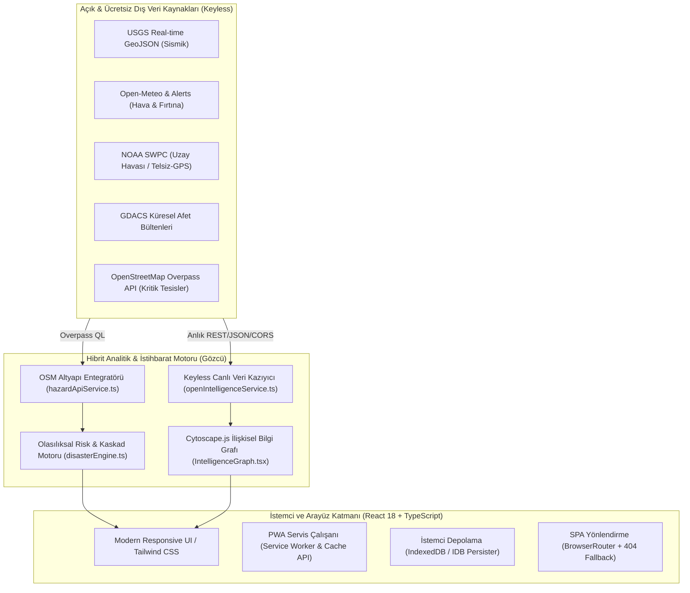

# İstanbul Afet Koordinasyon ve Hibrit Karar Destek Platformu
## Akademik Sistem Mimarisi, Matematiksel Modelleme ve Operasyonel Kullanım Kılavuzu

---

### Özet (Abstract)
Büyük metropollerde afet yönetimi, yalnızca olay gerçekleştikten sonra sahadan veri toplamakla (reaktif yaklaşım) sınırlandırılamaz; iklim krizi, plansız kentleşme ve çoklu tehlike (multi-hazard) etkileşimleri nedeniyle kaskad (zincirleme) riskleri öngören **proaktif ve olasılıksal bir karar destek sistemi** zorunludur. Bu çalışmada sunulan **İstanbul Afet Koordinasyon ve Hibrit Karar Destek Platformu**, operasyonel saha yönetimini (hasar tespiti, olay ve görev atama, kaynak koordinasyonu, PWA tabanlı çevrimdışı senkronizasyon) **Gözcü Olasılıksal Hasar ve İstihbarat Motoru** ile entegre etmektedir. 

Sistem; USGS, Open-Meteo, NOAA Space Weather ve GDACS gibi açık kaynaklı (keyless/ücretsiz) veri akışlarını anlık olarak kazıyarak kural tabanlı anomali analizi yapmakta, elde edilen verileri **Cytoscape.js tabanlı ilişkisel bir bilgi grafında (Knowledge Graph)** modellemekte ve OpenStreetMap Overpass API altyapı taramasıyla birleştirerek dinamik hasar oranı (MDR), olası maksimum ekonomik kayıp (PML) ve altyapı çökme olasılığı hesaplamaktadır.

---

## 1. Giriş ve Problem Tanımı

İstanbul, Kuzey Anadolu Fay Hattı'nın (KAF) Marmara segmenti üzerinde yer alması sebebiyle yüksek sismik risk altındadır. Yaklaşık 16 milyonluk nüfus ve yüksek bina yoğunluğu, afetin yalnızca birincil sarsıntıyla sınırlı kalmayacağını; doğalgaz patlamaları, su ve elektrik şebekesi kesintileri, ulaşım arterlerinin tıkanması ve kritik kamu binalarının (hastaneler, itfaiyeler) erişilemez hale gelmesi gibi ikincil ve üçüncül kaskad etkileri doğuracağını göstermektedir.

Geleneksel afet bilişim sistemlerinin yaşadığı temel kısıtlar şunlardır:
1. **Veri Siloları ve Asimetrisi:** Sismik veriler, meteoroloji tahminleri, kamu altyapı envanteri ve saha hasar bildirimleri ayrı platformlarda dağınık kalmaktadır.
2. **Reaktif Doğası:** Sistemlerin büyük kısmı sadece hasar veya yardım talebi girildiğinde tepki vermekte, olay öncesi veya hemen sonrasındaki "altın saatlerde" kestirimsel senaryo üretememektedir.
3. **Ağ Kesintilerine Karşı Kırılganlık:** İnternet ve elektrik kesintilerinde merkezi sunucuya bağımlı web uygulamaları tamamen işlevsizleşmektedir.

Bu çalışma, `afetproje` ve `hasar` depolarının yeteneklerini tek bir potada eriterek bu kısıtları bertaraf eden hibrit bir ekosistem sunar.

---

## 2. Sistem Mimarisi ve Teknoloji Yığını

Platform, gevşek bağlı (loosely coupled) ve yüksek dayanıklılığa sahip katmanlı bir mimariyle tasarlanmıştır.

### Teknoloji Bileşenleri
* **Frontend:** React 18, TypeScript, Vite, Tailwind CSS, Lucide Icons.
* **Durum ve Veri Yönetimi:** TanStack Query (React Query v5), Zustand, IndexedDB (`idb`).
* **Harita ve Mekânsal Görselleştirme:** Leaflet, React-Leaflet, MapLibre GL (3B bina desteği).
* **Graf ve Ağ Analizi:** Cytoscape.js (Dinamik eşmerkezli / concentric ve cose düzeni).
* **Dağıtım ve CI/CD:** GitHub Actions (`deploy-pages.yml`), GitHub Pages SPA (Single Page Application).

---

## 3. Matematiksel ve Olasılıksal Afet Modelleme Metodolojisi

Platformun simülasyon motoru (`disasterEngine.ts`), uluslararası afet risk yönetimi standartlarında (UNDRR, HAZUS ve GDACS kılavuzları) kabul görmüş parametreleri temel alır.

### 3.1. Temel Risk İndeksi ($R_{norm}$)

Normalleştirilmiş risk değeri; şiddet ($I$), maruziyet ($E$), kırılganlık ($V$) ve direnç ($R$) bileşenlerinin doğrusal olmayan ağırlıklı toplamı üzerinden hesaplanır:

$$R_{raw} = \frac{\left(\frac{I}{100}\right)^{1.2} \cdot w_i + \left(\frac{E}{100}\right)^{1.1} \cdot w_e + \left(\frac{V}{100}\right) \cdot w_v - \left(\frac{R}{100}\right) \cdot w_r}{3.0}$$

$$R_{norm} = \max\left(0.01, \, \min\left(R_{raw}, \, 1.0\right)\right)$$

Burada $w_i, w_e, w_v, w_r$ afet türüne göre belirlenen ağırlık katsayılarıdır:

| Afet Türü | Şiddet ($w_i$) | Maruziyet ($w_e$) | Kırılganlık ($w_v$) | Direnç ($w_r$) | Açıklama |
| :--- | :---: | :---: | :---: | :---: | :--- |
| **Sismik (Deprem)** | 1.8 | 1.0 | 2.0 | 2.0 | Yapı kalitesi ve mühendislik direnci baskındır. |
| **Sel / Taşkın** | 1.2 | 1.8 | 1.2 | 1.5 | Nüfus maruziyeti ve topoğrafya belirleyicidir. |
| **Yangın** | 1.5 | 1.2 | 1.5 | 1.8 | Meteorolojik rüzgar hamlesiyle yayılım hızlanır. |
| **Fırtına** | 1.8 | 1.2 | 1.5 | 1.5 | Rüzgar şiddeti altyapı hasarını tetikler. |
| **Kuraklık / Su Stresi**| 1.5 | 1.5 | 1.0 | 2.0 | Rezervuar direnci ve kentsel tüketim oranı esastır. |

### 3.2. Ortalama Hasar Oranı ($MDR$ - Mean Damage Ratio)

Belirli bir bölgedeki yapı stoğunun toplam fiziksel zarar görme oranını ifade eder (%0 ile %100 arasında normalize edilir):

$$MDR = \min\left(1.0, \, \left(\frac{I}{100}\right)^{1.5} \cdot \left(\frac{V}{100}\right)\right)$$

### 3.3. Olası Maksimum Ekonomik Kayıp ($PML$ - Probable Maximum Loss)

Bölgedeki ekonomik varlıkların maruziyet çarpanı ($E \cdot 500$ Milyon \$ tabanı), kaskad zincirleme etkisi ($C$) ve kentsel afet hazırlığı ($R$) ile ölçeklenir:

$$PML = (E \cdot 500) \cdot MDR \cdot \left(1 + \frac{C}{100} \cdot 0.5\right) \cdot \left(1 - \frac{R}{100} \cdot 0.3\right)$$

### 3.4. Yıllık Ortalama Kayıp ($AAL$ - Average Annual Loss)

$$AAL = PML \cdot \max\left(0.01, \, 1 - \frac{I}{100}\right)$$

### 3.5. Kritik Altyapı Çökme Olasılığı ($P_{collapse}$)

Elektrik, su, doğalgaz dağıtım ve fiberoptik haberleşme şebekelerinin eşzamanlı çöküş olasılığı:

$$P_{collapse} = \min\left(99, \, MDR \cdot 100 \cdot 1.2 \cdot \left(1 + (w_v - 1.5) \cdot 0.2\right)\right)$$

---

## 4. Keyless Açık Kaynak İstihbarat (OSINT) ve Anomali Algoritmaları

Platform, harici bir API anahtarı veya kota kısıtlaması olmadan kamuya açık bilimsel veri servislerini asenkron `fetch` boru hattıyla sorgular (`openIntelligenceService.ts`):

* **USGS Real-time Feeds:** Marmara ve Türkiye çevresindeki sismik hareketlilik, büyüklük, derinlik ve koordinatlar.
* **Open-Meteo & Alerts:** İstanbul anlık fırtına hamleleri, yağış ve sıcaklık.
* **NOAA Space Weather:** Jeomanyetik fırtınalar, K-indeksi ve telsiz/GPS acil haberleşme şebekesi aksama uyarıları.
* **GDACS (Global Disasters):** Küresel acil afet alarmları.

---

## 5. Çizge Teorisi ve Cytoscape İlişkisel Bilgi Grafı

Platform, tehdit ilişkilerini yönlü bir çizge (directed graph) $G = (V, E)$ olarak modeller:
* **Düğüm Kümesi ($V$):** Olaylar ($V_{event}$), Konumlar ($V_{location}$), Kategoriler ($V_{category}$), Anomaliler ($V_{anomaly}$).
* **Kenar Kümesi ($E$):** `ETKİ ALANI`, `KRİTİK TEHDİT` ve `İLİŞKİLİ` rotaları.

Cytoscape.js motoru eşmerkezli (concentric) düzenleme kullanarak en yüksek bağlantı derecesine (degree centrality) sahip kritik olayları merkeze yerleştirir.

---

## 6. Operasyonel Kullanım Kılavuzu

Platforma **[https://mserman90.github.io/afetproje/](https://mserman90.github.io/afetproje/)** adresi üzerinden erişilebilir.

### 6.1. Giriş ve Demo Oturumu
1. Giriş ekranında (`/login`) veya Kayıt ekranında (`/register`) alt kısımda yer alan **“Giriş Yapmadan Admin Olarak Siteyi Gez”** düğmesine tıklayın.
2. İstemci taraflı bağımsız demo oturumu devreye girer ve sizi doğrudan Kontrol Paneli’ne yönlendirir.

### 6.2. Kontrol Paneli (`/dashboard`)
* Üst kısımda **“Dikkat Gerektirenler”** aksiyon merkezi yer alır.
* Açık olay sayıları, bekleyen hasar tespitleri, açık kaynak talepleri ve en son Kandilli/AFAD deprem kayıtları KPI kartlarında görüntülenir.

### 6.3. Operasyon Haritası ve "Kritik Altyapı Katmanı" (`/map`)
1. Sol menüden **Operasyon → Operasyon Haritası** sekmesine geçin.
2. Haritanın sağ üst köşesindeki **“Katmanlar”** menüsünü açın.
3. Listeden **“Kritik Altyapı (Hastane & İtfaiye)”** kutucuğunu işaretleyin:
   * 🏥 **Gül rengi ikonlar:** Devlet ve şehir hastaneleri, acil klinikler.
   * 🚒 **Turuncu ikonlar:** İtfaiye istasyonları ve müdahale amirlikleri.
   * 👮 **Mavi ikonlar:** İlçe emniyet müdürlükleri ve karakollar.
   * 🏫 **İndigo ikonlar:** Tahliye ve geçici toplanma okulları.
4. Harita üzerindeki herhangi bir kritik tesis ikonuna tıklayın:
   * Sol alt köşede açılan bilgi kartından tesisin tam adı, koordinatları ve **“Google Harita'da Yol Tarifi”** butonuyla anlık rota oluşturabilirsiniz.

### 6.4. Olasılıksal Afet & Hasar Simülatörü (`/simulations`)
1. Sol menüden **Sistem Yönetimi → Simülasyonlar** sayfasına gelin.
2. Varsayılan olarak açık gelen **“Olasılıksal Afet & Hasar Analizi (Gözcü)”** sekmesini kullanın.
3. Sağ üstteki açılır menüden simüle etmek istediğiniz İstanbul ilçesini (ör. *Kadıköy, Avcılar, Fatih*) seçin.
4. **Verileri Yenile:** Tıkladığınızda sistem ilgili ilçenin koordinatları etrafındaki Open-Meteo hava durumunu ve OSM kritik tesis sayılarını canlı çeker.
5. Şiddet, maruziyet, kırılganlık, direnç ve kaskad sürgülerini ayarlayın.
6. Otomatik hesaplanan **MDR (% hasar)**, **PML (\$M kayıp)** ve **Kaskad Zincirleme Senaryosu** kartlarını inceleyin.

### 6.5. Canlı Tehdit ve İlişki Bilgi Grafı (`/coordination-center`)
1. Sol menüden **Operasyon → Koordinasyon Merkezi** sekmesini açın.
2. Üst sekmelerden **“Canlı Tehdit Bilgi Grafı (Gözcü)”** sekmesine geçin.
3. Ekranda beliren Cytoscape ağında düğümleri inceleyin, filtreleri kullanın ve herhangi bir düğüme tıklayarak detay çekmecesini görüntüleyin.

---
*© 2026 İstanbul Afet Koordinasyon Platformu — Açık Kaynak Afet Bilişim Ekosistemi.*
